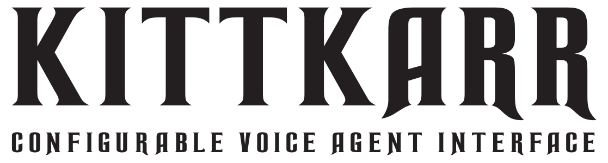

<p align="left">
  <picture>
    <source media="(prefers-reduced-motion: reduce)" srcset="assets/branding/voicebox-still.png">
    
  </picture>
  <picture>
    <source media="(prefers-color-scheme: dark)" srcset="assets/branding/title-dark.svg">
    <source media="(prefers-color-scheme: light)" srcset="assets/branding/title-light.svg">
    
  </picture>
</p>

A Knight Rider-inspired, audio-reactive agent voice interface for a Mac browser or a USB-connected Car Thing. Includes the LED voicebox visualizer, configurable speech and UI. Plugin any cloud or local voice service (e.g. voicebox or kokoro)

## Start on a Mac

Install Node.js 22.12+ and FFmpeg, then run:

```sh
npm ci
npm run setup
npm start
```

Choose **Mac browser**, then open **http://127.0.0.1:4180**. The default uses the Mac system voice. No paid voice account is required. For the standalone audio panel, use `npm run preview` and open **http://127.0.0.1:4173**.

- [Mac setup, conversation, and microphone input](docs/SETUP.md)
- [USB Car Thing installation and restore](docs/CARTHING.md)
- [Cloud and local voice providers](docs/VOICE.md), including Kokoro-compatible endpoints and adapters for other services
- [Optional integrations](docs/OPTIONAL.md)

Speech synthesis, transcription, and conversation are independently configured. No cloud service is enabled automatically. Local system speech is available immediately; general conversation and microphone transcription need the services or models you select.

## Development

```sh
npm run check
npm test
npm run device:dashboard
npm run build
```

Browser checks: `npx playwright install chromium`, start `npm run preview` in another terminal, then run `npm run test:browser`. Optional camera Python tests need their separate dependencies. See `docs/OPTIONAL.md`.

## Privacy and hosting

Keep keys in your local ignored `.env`. Generated audio, reminders, model files, logs, device backups, and local service configuration stay in ignored directories. The servers expose only explicit public-file allowlists. The default assistant has no connected work accounts. Cloud services receive only requests made through the components you explicitly configure.

The assistant runs locally. A domain redirect to this repository does not host the assistant or need access to its secrets. No Vercel project binding, public speech function, deployment workflow, or automatic release is included.

This is an unofficial fan project, not affiliated with Knight Rider rights holders, Spotify, or any voice provider. Third-party code and font notices are retained in their respective directories. See [THIRD_PARTY_NOTICES.md](THIRD_PARTY_NOTICES.md).

## License

KITTKARR's original code is licensed under the [MIT License](LICENSE). Third-party code, fonts, and assets retain their respective licenses and notices.
