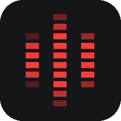
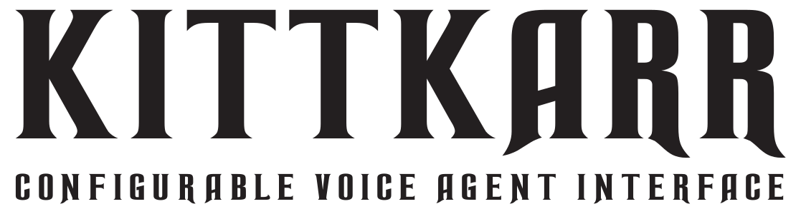

<p align="center">
  <picture>
    <source media="(prefers-reduced-motion: reduce)" srcset="assets/branding/voicebox-still.png">
    
  </picture>
  <picture>
    <source media="(prefers-color-scheme: dark)" srcset="assets/branding/title-dark.svg">
    <source media="(prefers-color-scheme: light)" srcset="assets/branding/title-light.svg">
    
  </picture>
</p>

<p align="center">
  <a href="LICENSE"></a>
  <a href="package.json"></a>
  <a href="docs/SETUP.md"></a>
  <a href="docs/CARTHING.md"></a>
  <a href="docs/VOICE.md"></a>
  <a href="https://kittkarr.com"></a>
</p>

A Knight Rider-inspired, audio-reactive voice interface for **Car Thing, SidePulse Pro, or both together**, hosted on your Mac. A Mac browser works on its own too. Includes the LED voicebox visualizer, configurable speech and UI. Connect a compatible cloud or local voice service.

## Start on a Mac

Install Node.js 22.12+ and FFmpeg, then run:

```sh
npm ci
npm run setup
npm start
```

Setup asks which hardware you want, checks its prerequisites, and offers installation at login. It preserves existing voice and account settings. `npm start` opens **http://127.0.0.1:4180**, reusing an installed/running host when available.

Open **Details → Settings** and choose **Test voice** or **Test LEDs**. The default Mac voice and LED test need no AI account. Both outputs follow the same reply when Car Thing and SidePulse are selected together. Run `npm run doctor` for connection help, or rerun setup to change hardware.

Car Thing requires compatible ClaudeThing firmware and its Mac collector. SidePulse requires one **SidePulse Pro in mounted-drive mode** and its [official companion](https://github.com/inteliwear/sidepulse#installation). The assistant host runs on macOS; SidePulse Dot is not currently supported.

For the standalone audio panel, use `npm run preview` and open **http://127.0.0.1:4173**.

- [Hardware setup, first voice/LED test, and microphone input](docs/SETUP.md)
- [USB Car Thing installation and restore](docs/CARTHING.md)
- [Cloud and local voice providers](docs/VOICE.md), including Kokoro-compatible endpoints and adapters for other services
- [Optional integrations](docs/OPTIONAL.md)

Speech synthesis, transcription, and conversation are independently configured. No cloud service is enabled automatically. Local system speech is available immediately; general conversation and microphone transcription need the services or models you select.

## Development

```sh
npm run check
npm test
npm run device:dashboard
npm run build
```

Browser checks: `npx playwright install chromium`, start `npm run preview` in another terminal, then run `npm run test:browser`. Optional camera Python tests need their separate dependencies. See `docs/OPTIONAL.md`.

## Privacy and hosting

Keep keys in your local ignored `.env`. Generated audio, reminders, model files, logs, device backups, and local service configuration stay in ignored directories. The servers expose only explicit public-file allowlists. The default assistant has no connected work accounts. Cloud services receive only requests made through the components you explicitly configure.

The assistant runs locally. A domain redirect to this repository does not host the assistant or need access to its secrets. No Vercel project binding, public speech function, deployment workflow, or automatic release is included.

This is an unofficial fan project, not affiliated with Knight Rider rights holders, Spotify, or any voice provider. Third-party code and font notices are retained in their respective directories. See [THIRD_PARTY_NOTICES.md](THIRD_PARTY_NOTICES.md).

## License

KITTKARR's original code is licensed under the [MIT License](LICENSE). Third-party code, fonts, and assets retain their respective licenses and notices.
